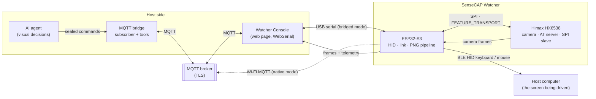
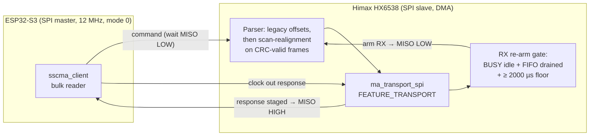

# Watcher Input Assistant

**Turning a Seeed Studio SenseCAP Watcher into an AI-driven input assistant.**

The Watcher is a small round device built around an ESP32-S3 with a Himax
HX6538 co-processor running its camera. Out of the box it's a capable
AI-camera gadget. This project re-purposes it as something different: a
physical *input device* with eyes — a BLE HID keyboard and mouse whose
touchscreen works as a touchpad, whose wheel works as a scroll wheel, which
listens for on-device voice triggers, and whose camera acts as "eyes on the
screen" for a host AI agent.

The loop looks like this: the Watcher takes a picture of the screen in front
of it, the frame travels to a host agent, the agent looks at the picture and
decides where to click, and the Watcher executes the click (and the typing,
and the scrolling) over BLE HID — exactly as if a person were sitting there
with a keyboard and mouse. Every hop in that loop is fast, byte-exact, and
cryptographically sealed, and getting it that way is most of what's in this
repository.

## What it does

- **BLE HID keyboard + mouse** (NimBLE composite device: keyboard, mouse,
  consumer control, battery service) — the primary input path to the host
  computer.
- **Touchscreen as touchpad**, the device's wheel as a scroll wheel, and
  push-to-talk / wake-word voice triggers on-device.
- **Eyes on the screen**: camera stills captured on the Himax, pulled across
  a custom SPI link to the S3, encoded to PNG, and delivered to the host
  agent for visual decisions; the resulting clicks and keystrokes go back
  out over HID.
- **Two transports, both first-class**: a *bridged* mode (USB serial →
  browser console page → MQTT) for tethered bench work, and a *native* mode
  (the S3 speaks Wi-Fi MQTT itself) that is the end state.
- **Sealed commands only**: the device executes a control command if and
  only if it carries a valid cryptographic seal under a PKI trust chain —
  it checks authenticity and key scope, never an allowlist of "wisdom".

## System overview

- The **ESP32-S3** runs the show: BLE HID, the command link, the PNG
  encode pipeline, and the SPI master that talks to the camera chip.
- The **Himax HX6538** owns the camera (the S3 has no direct camera
  interface) and serves frames to the S3 over SPI via a custom transport
  described below.
- The **console page** is the operator's cockpit and, in bridged mode, the
  MQTT⇄serial relay. The **bridge** (`host-agent/mqtt-bridge/`) is a
  long-running subscriber plus the bench tooling (sealed command sender,
  firmware transfer, frame reassembler, bench lock, health checks).

## Trust model in one paragraph (the "seal")

Commands are authenticated with **WMS2**: control commands carry Ed25519
signatures (RFC 8032), telemetry is protected with a BLAKE2b MAC plus
XChaCha20-Poly1305 encryption, and every envelope is bound to its MQTT
topic and a monotonic replay counter. Keys hang off a PKI tier chain —
an offline Tier-0 root, a Tier-1 provisioning tier, and device-pinned
commander keys whose *scopes* are enforced on-device at verify time (a
least-privilege key physically cannot flash firmware or change
permissions). Provisioning and recovery happen over serial only:
physical access is root. The device verifies every command's seal
itself — in bridged mode the console page is a relay, never a trust
anchor. Full design: `host-agent/mqtt-bridge/MQTT_SEAL_ARCHITECTURE.md`.

## The Himax firmware

This is where a stock part of the project turned into a project of its own.

### A transport that didn't exist

Seeed's SSCMA port for the HX6538 ships with console, UART, and I2C
transports for its AT command server — but **no SPI slave transport**,
and SPI is the only high-bandwidth path from the Himax to the S3. So we
wrote one: `ma_transport_spi.cpp` implements the SSCMA
`FEATURE_TRANSPORT` protocol (feature `0x10`) as an SPI slave with DMA,
256-byte packets, a 4-byte header (`feature, cmd, len_hi, len_lo`), and
CRC-16-CCITT integrity per packet. Command set: READ, WRITE, AVAILABLE,
START, STOP, RESET, READ_CRC, TEST_PATTERN, PARK. The single AT server
now serves identical commands over UART and SPI; only the transport
differs.

Because a half-duplex SPI slave can't say "my answer is ready" in-band,
readiness rides on the MISO pin itself: the Himax swaps PB2 between a
GPIO function (driven LOW = *RX armed, safe to send*) and the SPI data-out
function (released = *response staged*; the S3's internal pull-up floats
MISO HIGH in under a microsecond). "Response staged" and "pin connected"
are one atomic pinmux action, which is what makes the handshake race-free
— an earlier design that signalled through an I/O expander turned out to
be electrically broken (a floating node behind a diode) and was abandoned
on the strength of an independent review.

### The 35-second problem, and the road to ~4 seconds

A full-resolution frame pull originally took a **median 35.66 s** over
50 measured transfers. Two plausible theories for why were both wrong;
what settled it was instrumentation on both chips at once:

- S3-side `bulk_stats` counters showed the S3 spending ~89% of the wall
  simply *waiting* for the Himax to say "ready" again (`wait_low`).
- 10,179 Himax-side transfer records showed its frame feeder was never
  starved — the famous "runt chunk" pattern was an artifact of the
  AVAILABLE reply snapshotting the ring in the same instant it was
  popped.

The actual toll was a Himax safety guard: after every response, the
slave waited a fixed **25/30 ms timer** before re-arming its receiver —
105 ms per chunk pair × 308 pairs ≈ 91% of the wall. It had been layered
on because the TX-DMA completion callback fires when the DMA has fed
the FIFO, *before* the master has clocked the bytes out; an earlier
attempt to poll the SPI peripheral's registers directly for a real
"drained" signal bus-faulted the chip mid-transfer and was reverted.

The fix, in three validated steps:

| Step | Change | Bulk wall |
|---|---|---|
| S3 0.4.23 | Threshold re-poll (never read a runt: wait until enough bytes are staged), escalating backoff, `bulk_stats` counters | 35.7 s → ~27.5 s |
| Himax .58 | Instrumentation only: driver-mediated status probes (BUSY / TX-available / status register) sampled against DMA-done across 11,408 responses — all clear within ~1 ms; the interrupt-status "done" bit never fires on this driver | (no change, by design) |
| Himax .59 | **Signal-driven re-arm**: arm RX when the driver signals read drained *and* ≥ 2000 µs have passed (the master's minimum inter-command gap); the 25/30 ms timer demoted to a counted fallback ceiling that, in validation, never fired | **3,717 ms** (`wait_low` 24.6 s → 0.85 s) |
| Himax .60 | Parser scan-realignment (below) | 4,026 ms, zero CRC failures |

Deliberate re-arm telemetry counters (signal arms vs fallback arms,
per-signal latencies) shipped *with* the fix, not after it — they are
the early-warning system if the link ever degrades in the field, and
they cost nothing measurable.

### Parser scan-realignment (.60)

The fast re-arm exposed one residual race: when the S3 drains its TX
FIFO against a busy link, up to a burst of stale bytes can spill in
front of the next command. The Himax parser historically tolerated
exactly 2 spill bytes; a bigger spill ate the command whole (the slave
then sat silent, the master timed out, and failures cascaded). The .60
parser keeps the legacy offset checks byte-for-byte, but any frame they
reject now goes through a **scan over all offsets**: a candidate frame
must carry the transport feature byte, a known command, and a *valid
CRC* — so a spilled frame is recovered at whatever offset it landed,
and garbage can never validate by accident. In validation under the
same post-boot conditions that previously cascaded, the scan recovered
real spills at offsets 64 (exactly one 64-byte drain burst — the spill
source, measured at last) and 9, with **zero dropped commands**; the
spitest link test ran **159/160** across two 80-test gap-0 batches (the
single failure was a response-side CRC flake with 73 historical
occurrences across firmware eras), frames arrived **byte-exact**, and
bulk stayed at ~4 s with zero CRC failures.

### Customizing the Himax firmware

The Himax side started as Seeed's SSCMA example app
(`EPII_CM55M_APP_S/`) and has been reworked into a **capture-only
camera server**: the stock on-chip inference pipeline is out, and
what remains is the AT command server, sensor control, and our SPI
transport. Everything project-specific lives in that fork:

- the `FEATURE_TRANSPORT` SPI slave described above;
- a sensor preset table whose top entry (preset 8) is a full-frame
  1296×972 RAW8 capture mode — see *Imaging* below;
- `AT+SPIDUMP`, the capture-and-stage command behind the SPI bulk
  frame pull;
- the signal-driven RX re-arm gate and the parser scan-realignment;
- build fingerprinting: `WATCHER_BUILD_HASH`, generated from the key
  sources by `gen_build_hash.sh` and printed at boot, so the running
  artifact can be identified unambiguously.

Customizing it further follows the shape those changes established:

- **New AT commands** are registered with `addService()` in
  sscma_micro's AT server (`library/sscma_micro/sscma/server/at/ma_server_at.cpp`;
  larger handlers live under `callback/`). `AT+SPIDUMP` is the
  worked example: it captures a frame and stages it, with length
  and SHA-256, for the SPI bulk read. Because there is a single AT
  server, a command registered once is served identically over
  UART and SPI; only the transport differs.
- **Sensor behavior** is data, not code paths: modes live in the
  firmware's preset table, the S3 discovers them at link-up with
  `AT+SENSORS?` and selects by *resolution*, and `AT+SENSOR?`
  reports the live mode. Host code never hardcodes preset IDs, so a
  Himax-side table change doesn't silently break the S3.
- **Versioning is two lines, deliberately.** Himax builds carry
  their own version (current: 0.4.20.60) independent of the S3's
  0.4.x line, and the boot print pairs it with the build
  fingerprint. Trust the fingerprint, not the filename.

### Building and flashing the Himax firmware

- Toolchain: ARM GNU 13.2; the app lives in
  `sscma-fork/sscma-example-we2-main/EPII_CM55M_APP_S/`.
- **Always `make cleanbuild`.** It regenerates the build fingerprint
  (`gen_build_hash.sh` → `WATCHER_BUILD_HASH`) from the key sources and
  does a full clean — the tree's header dependency tracking is broken,
  and partial rebuilds have repeatedly produced binaries that didn't
  match their source. Every artifact is verified *by reading it back*
  (version string, full fingerprint, markers in the packaged image),
  never by trusting a version number.
- Packaging uses Seeed's secure-image generator; the result is a
  622,592-byte signed image. Flashing is by **XMODEM at 921600 baud**
  over the Himax's UART channel (`flash_himax.py` in the flash kit
  holds the S3 in reset during the transfer so the SPI link stays out
  of the way). The person, not the agent, runs the flash.

## Imaging: the full frame

The camera is an OmniVision OV5647 — 5 MP, 2592×1944 native,
120° FOV, fixed focus at 3 m — wired to the Himax. The S3 never
touches it directly; it receives frames only over the SPI bulk
pull described above.

Sensor modes are discovered, never assumed. At link-up the S3
asks the Himax for its mode table (`AT+SENSORS?`) and selects
modes by *resolution*; `AT+SENSOR?` reports the live mode. Most
of the table is inference-era sizes — presets from 240×240 up to
640×480, meant for models running on the Himax itself. The entry
this project runs on is the top one:

**Preset 8: 1296×972 RAW8 — the full frame.** Every capture the
input assistant makes is the complete 1296×972 frame
(1,259,712 bytes of RAW8), pulled over SPI in ~4 s, debayered and
PNG-encoded on the S3 — whose frame buffer is sized exactly to
it. As far as we know, that makes this the only project pulling
full frames off this device: stock firmware and the wider SSCMA
ecosystem work at inference resolutions, because they are built
to run models on-chip. This firmware is capture-first — the
model lives on the host — so the full frame is the point. For an
agent reading a screen, those pixels are the difference between
guessing at text and reading it.

## The S3 firmware

ESP-IDF (v5.3), components under `firmware/components/` — `hid_ble`,
`eyes` (capture + PNG pipeline), `link` (the command/telemetry path),
`sscma_client` (the SPI master), plus `seal` and `pki` for the trust
chain, and mode/touch/wheel/wake-word input components. Highlights:

- **Sealed-only control, reads included.** Discrete queries verify
  exactly like commands; scopes are enforced at verify time.
- **The PNG pipeline**: 1296×972 full frames (see *Imaging*) are
  debayered, filtered, and deflate-encoded on-device (pure encode CPU
  measures ≈ 9 s — the wire, not the CPU, was always the wall), then
  streamed as chunked, length-tagged JSON.
- **Chunk-loss RCA, closed.** All device output shares one 32 KB PSRAM
  ring with a chasing reader, and two distinct loss mechanisms were
  found and fixed: a *lap deletion* (a chunk could leave the ring
  exactly 100% full, letting one log line silently delete a span
  mid-chunk — fixed with an 8 KB headroom margin in 0.4.21) and a
  *lock-contention drop* (`link_send`'s zero-tick try-lock lost races
  against log writers — fixed with a bounded-blocking push, ≤ 250 ms,
  in 0.4.22). Send failures now abort the transfer loudly instead of
  shipping a hole. Verification: five consecutive bridged snaptests,
  byte-exact end to end, ~857 chunk pushes, zero losses. The bridge's
  reassembler got the matching treatment — it grades streams and only
  saves a frame after a full PNG CRC walk and exact decompression.
- Delivery of new S3 firmware is itself a sealed, human-gated flow:
  chunks go over MQTT to the console page, the page verifies the hash,
  and a person clicks "flash".
- **Ack'd chunk streaming** (0.4.35+): image chunks can be gated on
  host acknowledgements — per-chunk CRC32, nack-triggered resend,
  baud-aware timeouts — so a transfer degrades loudly instead of
  shipping a hole.
- **Negotiated serial baud** (landed): the console link boots at
  115200 always, then negotiates up with round-trip confirmation and
  automatic fallback. The CH9102 bridge tops out at a measured,
  reproduced **750000** baud (107/107 clean); 921600 garbles from
  bridge-chip phase hunting, and 576000/691200/806400 are host-side
  dead zones. Design: `docs/baud-negotiation-design-2026-11-03.md`.
- **Voice, end to end** (0.4.37–0.4.45): on-device wake word
  ("Hi/Hey, Muse" — `wn10_himuse`, a WakeNet10 model Espressif
  trained and published after this project's feature request,
  esp-sr#88) plus push-to-talk, both feeding sealed audio takes to
  the host for transcription. Wake-word takes stop on a *dynamic*
  silence detector: thresholds derive from a rolling ambient-RMS
  measurement taken live in the room, never a fixed constant, with a
  4 s trailing-silence stop. Getting here required finding why the
  microphone had been silent since the project began: its supply
  rail is the ES8311 codec's reference output, which no firmware —
  stock-derived code included — ever switched on. The full audit is
  `docs/mic-audit-2026-11-07.md`; the fix (0.4.43) powers the codec
  at PTT init and never closes it.
- **On-device replies** (0.4.45+): a sealed `reply` command renders
  the host agent's answer on the Watcher's screen as a paced text
  reveal (~18 chars/s), so the device can answer back in the room,
  not just in a chat window. The message view's margins were set by
  measurement, not assumption: a ring diagnostic (0.4.46) drew
  concentric circles on the round panel, the operator read off the
  largest fully-visible one, and the text block was inscribed in
  that circle (0.4.47). Wheel scrolls the text; the reveal
  auto-scrolls to follow; the dwell is 15 s (0.4.48).

## Repo layout

| Path | What lives there |
|---|---|
| `firmware/` | ESP32-S3 firmware (ESP-IDF): HID, link, eyes/PNG, SSCMA SPI client, seal/PKI |
| `sscma-fork/sscma-example-we2-main/` | Himax HX6538 firmware: our fork of Seeed's SSCMA example; the SPI transport lives in `EPII_CM55M_APP_S/library/sscma_micro_porting/porting/himax/we2/ma_transport_spi.cpp` |
| `host-agent/mqtt-bridge/` | The bridge daemon, sealed command sender, flash transfer, tiered PNG reassembler, seal tooling, bench lock/health — plus the operations RUNBOOK and seal architecture docs |
| `host-agent/` | Earlier host-agent work: transports, vision, protocol |
| `docs/` | Design records and investigations — start with `docs/RUNBOOK.md` (system operations), then the deep-dives below |
| `tools/pki/` | PKI provisioning tooling for the seal trust chain |
| `cursor-model/`, `wakeword-training/` | On-device model work: cursor detection for the Himax NPU, wake-word training |
| `vendor/` | Read-only upstream reference trees (schematics, official firmware/BSP) — never built from directly; **kept locally, not tracked in this repo** |

Bench-runtime data — camera snapshots, audio captures, transfer
chunks, logs — is likewise local working state under
`host-agent/mqtt-bridge/` and not part of the published tree.
Project policy: **bench captures (screen snapshots and voice
recordings) are never published** — they are working data from a
person's home and desk, not project artifacts.

Deep-dives worth reading:
`docs/spi-subsystem-research-2026-10-09.md` (the SPI link, including the
measured re-baseline that overturned its own earlier theory),
`docs/a0-rearm-investigation-prep-2026-11-02.md` (the re-arm fix, phase
by phase), `docs/chunk-loss-rca-2026-11-02.md`,
`docs/bridge-reassembler-design-2026-11-02.md`,
`docs/sd-capture-audit-design-2026-11-02.md`,
`docs/baud-negotiation-design-2026-11-03.md`, and
`docs/mic-audit-2026-11-07.md` (how a microphone stays silent for two
months with every digital register correct).

## Status

**Working and bench-validated** (S3 firmware 0.4.48 + Himax firmware
0.4.20.60, console 0.4.188): BLE HID input; eyes-on-screen capture
with byte-exact frame delivery; the SPI bulk path at ~4 s (from
35.7 s) with zero CRC failures; sealed command control with
device-side verification; negotiated serial baud (750000 top rung);
ack'd chunk streaming; and the **complete voice loop** — wake word
or push-to-talk in, transcription on the host, the answer rendered
back on the device's screen. The console + bridge toolchain is the
daily driver for all of it. Still on the list: the formal 20-frame
soak for the SPI work (validation so far: 160 link tests, 923+ bulk
commands, multiple full frames).

**Known issue (root-caused, fix in 0.4.49):** an interrupt-watchdog
panic in the legacy I2C path recurred across 0.4.40–0.4.48 (five
sightings, always during quiet wake-word listening, always with
clean recovery). Symbolizing the panic backtrace against the build
established the chain: the vendor IO-expander driver's read cache
never engages on a part configured without an interrupt pin, so the
10 ms wheel-button poll was issuing a real I2C transaction
~100 times a second; a rare bus timeout then dropped the legacy
driver into its FSM-reset path, which occasionally spun in ISR
context past the interrupt watchdog. The fix samples the button at
50 ms with a failure backoff and runs I2C0 at 100 kHz instead of
400 kHz. (The watchdogs stay enabled — a watchdog firing on a hang
is correct behavior.) Full record:
`docs/i2c-isr-wdt-investigation-prep-2026-11-08.md`.

**Next, in order:**

1. **Streaming audio shipping** (built in 0.4.49, in verification):
   a take used to be captured in full, then sent — with no flow
   control, so chunks could be lost in transit. 0.4.49 puts a PSRAM
   ring buffer between capture and a dedicated sender task so sends
   overlap capture; streamed chunks carry their chunk total only on
   the final chunk, and the bridge and console reassemblers were
   updated to match. (Extending the image path's ack gate to audio
   is the follow-on candidate.)
2. **Native Wi-Fi MQTT (Track B)**: the device on the broker
   directly, alongside — not instead of — the tethered mode. First
   the mirror-queue fix (bounded-blocking enqueue + drop counter)
   so image bytes can never be silently dropped, then chunks bypass
   the serial ring entirely when native is up.
3. **SD capture audit log** (designed): every capture — PNG and
   audio — also lands on the device's SD card with an append-only
   index, as the device-side source of truth behind the console's
   privacy log. A full card stops auditing and says so; it never
   silently overwrites.
4. Encode-CPU trims (Track C) once both transports land and the CPU
   becomes the wall.

## Hardware notes

- Never power the board above 5 V. Of the two USB-C ports, the bottom
  one is the data/flash port (a dual USB-UART bridge: one channel to
  the S3 console, one to the Himax); the other is power-oriented.
- The camera belongs to the Himax HX6538; the S3 only ever receives
  frames via SSCMA/SPI. Vision decisions are host-assisted by design.
- Bench rule that explains half the commit history: *instrument first,
  guess never* — every performance claim in this README traces to a
  counter or a log line in `docs/`.
